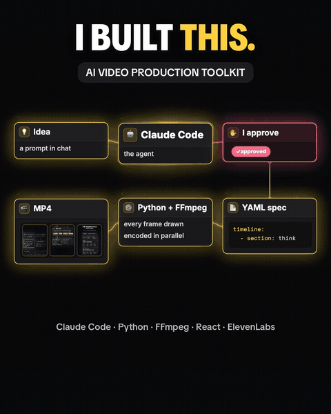
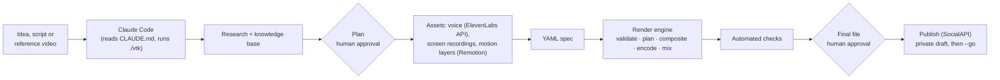

# Claude Video Toolkit

[](https://github.com/pavanmulka/claude-video-toolkit/actions/workflows/ci.yml)
[](LICENSE)

**A spec-driven short-video engine, operated by an AI agent.** Every video is a YAML spec; a Python + FFmpeg engine
renders it frame by frame into a finished MP4 (captions, voice-over, music, motion graphics), and Claude Code runs the
whole workflow from idea to publish, with a human approval step before anything is made and before anything is posted.

<p align="center"></p>
<p align="center"><sub>The pipeline below, animated. This clip was rendered by the toolkit from a spec.</sub></p>

## How it works



A new video needs a new spec, not new code. When a video needs something the spec can't express, it is added to the
engine as a general, documented option (a new layout, animation, motion look or command) and becomes available to every
future spec.

## A spec

```yaml
version: 1
name: demo
theme: deep_space
output: {aspect: "9:16", fps: 30}
timeline:
  - section: hook
    text: {content: "EVERY VIDEO\nIS A **SPEC.**", style: kinetic, pos: center}
    text_anim: {by: word, effect: stamp, stagger: 0.12, ease: spring}
    clips:
      - {color: transparent, dur: 2.6}
  - section: count
    text: {content: "Rendered from **one YAML file**", style: clean_title, pos: upper_third}
    clips:
      - {color: transparent, dur: 2.8, transition: {type: whip, dir: left}}
    overlays:
      - {counter: {from: 0, to: 100, suffix: "%", dur: 1.2}, style: counter, pos: ["50%", "52%"], anim: pop}
audio:
  music: {generate: {bpm: 120, key: D, seed: 7}, volume: -8}
```

`./vtk render examples/demo.yaml --preview` turns it into an MP4 with no footage at all. Real videos add screen
recordings, a voice-over and word-synced captions: see [`CLAUDE.md`](CLAUDE.md) for the full spec reference.

## Engine design

| stage | what happens | where |
|---|---|---|
| **Validate** | YAML schema check; every error names its exact field path and suggests a fix (`timeline[0].clips[0].sped: unknown field (did you mean 'speed'?)`) | `toolkit/spec.py` |
| **Plan** | the timeline becomes a frame-exact plan: which source frame shows at each output frame (speed ramps, holds, transitions, beat-snapped montages) | `toolkit/timeline.py`, `montage.py` |
| **Composite** | every frame drawn in Python (NumPy, OpenCV, Pillow): drawn iPhone / Android devices, 3D camera tilt via perspective warp, kinetic text, marks, taps | `toolkit/compositor.py`, `device.py`, `text.py` |
| **Subject masks** | Apple Vision (a small Swift helper, on device) cuts out people and hands so text can sit behind them | `toolkit/subject.py`, `toolkit/native/` |
| **Phone plates** | a recording warped into filmed green-screen phone footage; the screen's 4 corners are tracked every frame | `toolkit/screenplate.py` |
| **Motion graphics** | 50+ React components (Remotion) rendered as cached layers, props validated with zod | `motion/` |
| **Encode** | x264 in parallel chunks, then joined | `toolkit/render.py` |
| **Audio** | voice-over lines anchored to on-screen moments, music ducked under the voice, loudness normalised (LUFS), captions from Whisper word timestamps aligned to the script | `toolkit/audio.py`, `captions.py` |
| **Self-check** | contact sheet, one-frame-glitch scan, platform safe zones, loudness report | `toolkit/contactsheet.py`, `safezones.py` |
| **Publish** | one API for five platforms; uploads as a private draft, and only an explicit `--go` publishes | `toolkit/publish.py` |
| **Knowledge base** | analyses reference videos (cuts, transcript, sound map) and keeps one lesson per line with its proof, in capped pages | `toolkit/kb.py`, `trends/` |

## Project layout

```
claude-video-toolkit/
├── vtk                  CLI entry point (./vtk <command>, runs in .venv)
├── CLAUDE.md            operating manual the agent follows: workflow, rules, spec reference
├── toolkit/             the engine (Python)
├── motion/              motion-graphics looks (Remotion + React + TypeScript)
├── templates/           15 video-format templates for ./vtk new
├── examples/            footage-free example specs (demo, kinetic stats, carousel, beat reveal, …)
├── brand/default/       base brand, themes and styles every brand extends
├── trends/              the knowledge base: BRAIN.md + one page per topic
├── tests/               pytest suite
├── docs/                getting-started guide, media
└── workspace.example/   template for the private, git-ignored workspace/ (brands, specs, ideas)
```

Everything personal (brands, video specs, ideas, recordings, API keys) stays out of the repo: `workspace/` and
`inbox/` are git-ignored, and API keys live in the macOS Keychain.

## Quick start

Requirements: macOS, Python 3.11, FFmpeg (with libass and rubberband), Node 24 for motion looks.

```bash
./setup.sh                                   # venv, Python deps, fonts, workspace/ from workspace.example/
./vtk render examples/demo.yaml --preview    # renders a test video with no footage
.venv/bin/python -m pytest                   # tests
```

New to the command line? The step-by-step guide is in [docs/getting-started.md](docs/getting-started.md).

## Commands

| command | does |
|---|---|
| `./vtk inspect` | analyse inbox footage: duration, fps, idle stretches, contact sheets |
| `./vtk new <name> --template <t>` | start a spec from a format template |
| `./vtk validate <spec>` | errors with field paths, the timeline, every spoken phrase at output time |
| `./vtk render <spec>` | render (`--preview`, `--frames`, `--aspect`, `--all-variants`) |
| `./vtk voiceover <file>` | Whisper transcript with word timestamps |
| `./vtk eleven say "…"` | ElevenLabs voice-over takes |
| `./vtk learn <url>` | analyse a reference video into the knowledge base |
| `./vtk publish <post.yaml>` | private draft on the connected platforms; `--go` publishes |

The full list, with every option, is in [`CLAUDE.md`](CLAUDE.md).

## License

[MIT](LICENSE). Fonts keep their own SIL Open Font License (`brand/fonts/LICENSES.md`).
